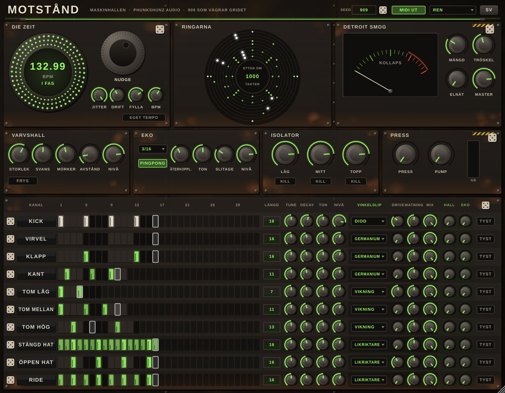

# MASKINHALLEN : MOTSTÅND

**Phunkshunz AUDIO** — en 909-maskin som vägrar gridet.

Egen drivande klocka med jitter och nudge, Brownsk "drunk walk" på cymbalernas
decay och tune, polymetriska loopar per instrument (7, 11, 13 mot kickens 16)
och **Detroit Smog**: master-bussen kollapsar när för många transienter slår samtidigt.
**VINKELSLIP** ger varje kanal sex sorters olinjär smuts, **VARVSHALL**, **EKO**, **ISOLATOR** och **PRESS** gör den till en hel studio, och **MIDI ut** skickar varje steg med Mills-timingen inbakad.

Status: steg 4c av 5 (ljud, VINKELSLIP, MIDI ut, DOCKLANDS-panelen och studioeffekterna klara).

Se [SPEC.md](SPEC.md).

> Arbetsnamn var DAS WERKZEUG. Repot hette tidigare FASLÅSET (Faslaset-VSTi); den gamla koden finns kvar i git-historiken.
